# RoboFix

Este es un proyecto en Java de consola en el que se aplican los conocimientos adquiridos, tales como:

- Patrones de diseño
- Principios de diseño
- Manejo de excepciones (`try / catch`)
- Interfaces
- Programación orientada a objetos

El objetivo es rescatar el aplicativo del taller de reparación de robots **sin reescribirlo completamente**: entender el código existente, corregir sus defectos e implementar tres patrones de diseño (Adapter, Singleton y Memento).

---

## Código inicial

### Exploración y revisión de ejecución antes de modificar

**Hallazgos iniciales**

1. El sistema permite registrar energía negativa al ingresarla.
2. El sistema registra modos inexistentes al momento de agregarlos.
3. El sistema tiene un error de control de energía al momento de reparar: si se repara un robot varias veces, aunque el robot ya no tenga energía se le sigue restando, por lo tanto la energía queda en números negativos.
4. **¿Los dos talleres comparten el mismo inventario?**

    Realmente no comparten el inventario. Cada objeto `Taller` crea su propio `Inventario` con los mismos valores por defecto, así que al crear un nuevo taller se genera un inventario independiente. Si un taller descuenta una batería, el otro sigue creyendo que la tiene.

5. **¿Cómo podrías recuperar la configuración anterior del robot?**

    Para recuperar la configuración anterior del robot se aplica el patrón de diseño **Memento**, ya que es un patrón que guarda los estados de una instancia para restaurarlos después.

6. El sistema no tiene condicionales en el control del inventario: al quedarse sin producto y hacer una reparación, el sistema sigue restando y el inventario queda con cantidades negativas.

### Criterios de aceptación (evaluación del código inicial)

**Integrar el escáner antiguo**

- **¿El diagnóstico se realiza mediante la interfaz moderna?:** No. No existe ninguna interfaz; el `Taller` usa directamente la clase `EscanerAntiguo`.
- **¿La clase externa permanece intacta?:** Sí, pero solo porque nadie la adapta; el resto del sistema depende directamente de ella.
- **¿El código que utiliza el diagnóstico evita interpretar manualmente la respuesta?:** No. El `Taller` hace `split("\\|")` y accede a las posiciones del arreglo en `diagnosticar()` y en `reparar()`.
- **¿Se conservan el código del robot, el componente, el estado y el valor reportado?:** Solo como texto suelto dentro de un arreglo, sin ningún tipo ni validación.
- **¿Un resultado malformado evita producir un diagnóstico falso?:** No. Si la respuesta no trae cuatro campos, el programa falla con `ArrayIndexOutOfBoundsException`.

**Centralizar el inventario**

- **¿La clase `Inventario` controla la creación de su instancia?:** No, cualquiera puede hacer `new Inventario()`.
- **¿El constructor está protegido para no crear inventarios independientes?:** No, el constructor es público.
- **¿Los diferentes objetos `Taller` consultan el mismo inventario?:** No, cada taller crea el suyo.
- **¿Los repuestos no pueden quedar en cantidades negativas?:** No, `descontar()` resta sin validar.
- **¿Se impide descontar un repuesto inexistente o una cantidad no válida?:** No. Un repuesto inexistente provoca `NullPointerException` y una cantidad negativa termina sumando stock.
- **¿La consulta del inventario refleja los cambios desde cualquier módulo?:** No, cada taller ve solo su propia copia.

**Guardar y restaurar configuraciones**

- **¿Es posible guardar la configuración actual?:** No. No existe ningún objeto que capture los datos actuales de la instancia `Robot`, por lo tanto no es posible guardar sus configuraciones.
- **¿Es posible cambiar la energía y el modo?:** Sí, gracias a los setters que tiene la clase `Robot`, pero sin ninguna validación.
- **¿Es posible restaurar la configuración previamente guardada?:** No, porque nunca se guarda ninguna copia.
- **¿Restaurar evita alterar el código y el nombre del robot?:** No aplica porque no se puede restaurar. Además, `codigo` y `nombre` no son `final`, así que nada garantiza que no cambien.
- **¿Se impide guardar una configuración inválida?:** No. Ni siquiera se impide asignar una configuración inválida.
- **¿Intentar restaurar sin copia guardada muestra un mensaje comprensible?:** No existe la opción de restaurar.

**Corrección de bugs y buenas prácticas**

- **¿Se valida que la energía esté entre 0 y 100?:** No.
- **¿Se valida que el modo sea `NORMAL`, `AHORRO` o `MANTENIMIENTO`?:** No, acepta cualquier texto.
- **¿Se evita reportar una reparación como exitosa cuando falla?:** No, siempre imprime "Robot reparado correctamente".
- **¿Se impide que una reparación deje inventarios negativos?:** No.
- **¿Existe un comportamiento consistente cuando el diagnóstico no es válido?:** No, el programa se cae.
- **¿Se evita que un cambio de configuración parcialmente válido deje un estado inconsistente?:** No. Se asigna la energía y luego el modo por separado, sin validar ninguno.
- **¿Se usan nombres descriptivos, constantes y métodos con responsabilidades claras?:** No del todo. Hay números mágicos (`20`, `1`, posiciones del arreglo) y el `Taller` diagnostica, interpreta texto, descuenta inventario y modifica la energía en un mismo método.

---

## Código refactorizado

### Patrones de diseño utilizados

**Adapter (estructural)**

`AdaptadorEscanerAntiguo` implementa la interfaz moderna `EscanerExterno`. Por dentro llama al `EscanerAntiguo` (que no se modificó) y convierte su respuesta de texto `CODIGO|COMPONENTE|ESTADO|CONSUMO` en un objeto `Diagnostico`. El resto de la aplicación ya no conoce el formato con `|`.

**Singleton (creacional)**

`Inventario` tiene un constructor privado y un método `getInstancia()` que siempre devuelve la misma instancia. Todos los talleres comparten el mismo inventario.

**Memento (comportamiento)**

- **Originator:** `Robot`, que crea su copia con `guardarConfiguracion()` y la recupera con `restaurarConfiguracion()`.
- **Memento:** `Configuracion`, una clase inmutable (campos `final`, sin setters) que guarda energía y modo.
- **Caretaker:** `HistorialConfiguracion`, que solo guarda y entrega la copia, sin leerla ni modificarla.

### Principios de diseño aplicados

- **Responsabilidad única (SRP):** cada clase tiene un trabajo claro. El adaptador interpreta el escáner, el inventario controla el stock, el robot protege su propio estado y el taller coordina la reparación.
- **Inversión de dependencias (DIP):** `Taller` depende de la interfaz `EscanerExterno`, no de una clase concreta. Se puede cambiar de escáner sin tocar el taller.
- **Abierto/cerrado (OCP):** para soportar un escáner nuevo basta con crear otro adaptador; no hay que modificar el `Taller`.
- **Encapsulamiento:** se eliminaron los setters de `Robot`. La energía y el modo solo cambian a través de métodos que validan.
- **Inmutabilidad:** `codigo` y `nombre` son `final`, igual que los campos de `Configuracion` y `Diagnostico`.
- **Fallar rápido (fail-fast):** los datos inválidos se rechazan en el momento con un mensaje claro, en lugar de propagarse.
- **Validar antes de modificar:** `cambiarConfiguracion()` y `reparar()` revisan todas las condiciones antes de cambiar cualquier dato, así nunca queda un estado a medias.

### Criterios de aceptación (con la solución)

**Integrar el escáner antiguo**

- **¿El diagnóstico se realiza mediante la interfaz moderna?:** Sí. `Taller` llama a `escaner.escanear(robot)` a través de `EscanerExterno`.
- **¿La clase externa permanece intacta?:** Sí. `EscanerAntiguo` no se modificó.
- **¿El código que utiliza el diagnóstico evita interpretar manualmente la respuesta?:** Sí. `Taller` recibe un objeto `Diagnostico` con getters; el `split` vive únicamente dentro del adaptador.
- **¿Se conservan el código del robot, el componente, el estado y el valor reportado?:** Sí, los cuatro datos quedan en `Diagnostico`, con el consumo convertido a `int`.
- **¿Un resultado malformado evita producir un diagnóstico falso?:** Sí. Si la respuesta viene vacía, con campos de más o de menos, con un consumo no numérico o con el código de otro robot, el adaptador lanza una excepción y el taller muestra "No se pudo diagnosticar".

**Centralizar el inventario**

- **¿La clase `Inventario` controla la creación de su instancia?:** Sí, mediante `getInstancia()`.
- **¿El constructor está protegido para no crear inventarios independientes?:** Sí, el constructor es privado.
- **¿Los diferentes objetos `Taller` consultan el mismo inventario?:** Sí. La opción 6 lo confirma con el mensaje "¿Comparten inventario? Sí".
- **¿Los repuestos no pueden quedar en cantidades negativas?:** Sí, `descontar()` valida que haya stock suficiente.
- **¿Se impide descontar un repuesto inexistente o una cantidad no válida?:** Sí, ambos casos lanzan una excepción con mensaje.
- **¿La consulta del inventario refleja los cambios desde cualquier módulo?:** Sí, al existir una sola instancia.

**Guardar y restaurar configuraciones**

- **¿Es posible guardar la configuración actual?:** Sí, con la opción 8 del menú.
- **¿Es posible cambiar la energía y el modo?:** Sí, con la opción 4, ahora con validación.
- **¿Es posible restaurar la configuración previamente guardada?:** Sí, con la opción 9.
- **¿Restaurar evita alterar el código y el nombre del robot?:** Sí. El memento solo guarda energía y modo, y `codigo` y `nombre` son `final`.
- **¿Se impide guardar una configuración inválida?:** Sí. El constructor de `Configuracion` valida la energía y el modo.
- **¿Intentar restaurar sin copia guardada muestra un mensaje comprensible?:** Sí: "No hay una configuración guardada. Usa primero la opción 8."

**Corrección de bugs y buenas prácticas**

- **¿Se valida que la energía esté entre 0 y 100?:** Sí, con las constantes `ENERGIA_MINIMA` y `ENERGIA_MAXIMA`.
- **¿Se valida que el modo sea `NORMAL`, `AHORRO` o `MANTENIMIENTO`?:** Sí, mediante el enum `ModoOperacion`.
- **¿Se evita reportar una reparación como exitosa cuando falla?:** Sí. `reparar()` devuelve `boolean` e informa el motivo exacto del fallo.
- **¿Se impide que una reparación deje inventarios negativos?:** Sí, se revisa el stock antes de descontar.
- **¿Existe un comportamiento consistente cuando el diagnóstico no es válido?:** Sí. Siempre se muestra un mensaje y la reparación se cancela sin modificar nada.
- **¿Se evita que un cambio de configuración parcialmente válido deje un estado inconsistente?:** Sí. Si la energía o el modo son inválidos, no se cambia ninguno de los dos.
- **¿Se usan nombres descriptivos, constantes y métodos con responsabilidades claras?:** Sí. Por ejemplo `COSTO_ENERGIA_REPARACION`, `REPUESTOS_POR_REPARACION`, `AdaptadorEscanerAntiguo` en PascalCase y `mostrarInventario()`. El menú tampoco se cae si el usuario escribe letras.

### Pruebas de aceptación

Las capturas de cada prueba están en la carpeta [`imgs/`](imgs/).

| Prueba | Acción | Resultado esperado | Resultado obtenido | Evidencia |
|---|---|---|---|---|
| P1 | Consultar el robot | Mostrar código, nombre, energía y modo | Muestra `RX-01`, `Explorador`, `80`, `NORMAL` | 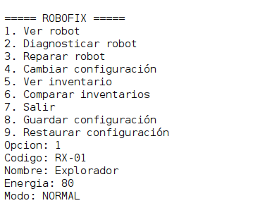 |
| P2 | Ejecutar diagnóstico | Obtener los datos interpretados mediante Adapter | Muestra robot `RX-01`, componente `BATERIA`, estado `CRITICO`, consumo `15` | 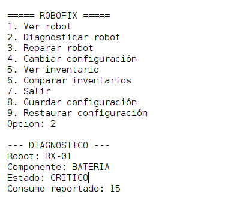 |
| P3 | Consultar el inventario desde ambos talleres | Ambos muestran las mismas cantidades | Ambos muestran `BATERIA: 2`, `MOTOR: 3`, `SENSOR: 4` y "¿Comparten inventario? Sí" | 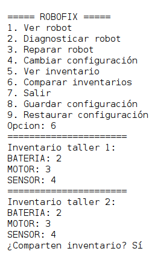 |
| P4 | Descontar una batería desde un taller | El otro taller refleja el descuento | Tras reparar en el taller 1, ambos muestran `BATERIA: 1` | 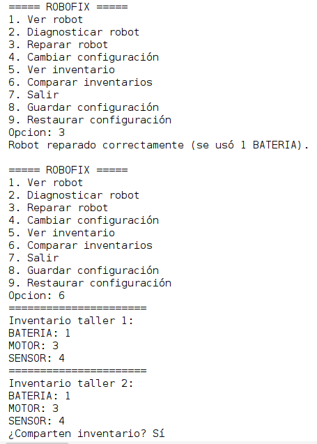 |
| P5 | Intentar descontar más repuestos de los disponibles | Rechazar la operación sin alterar el inventario | "Reparación fallida: no hay stock de BATERIA" y el inventario se queda en `0` | 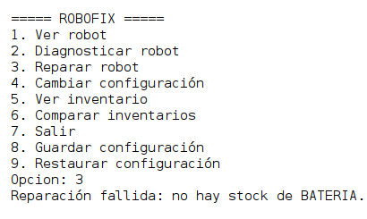 |
| P6 | Configurar energía en `-10` | Rechazar el valor | "No se cambió nada. La energía debe estar entre 0 y 100" | 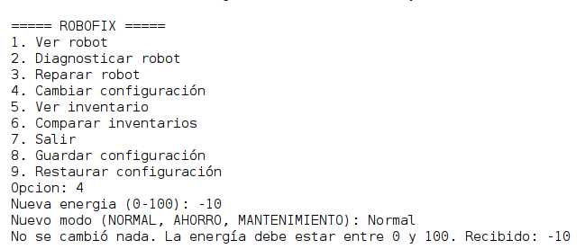 |
| P7 | Configurar energía en `150` | Rechazar el valor | "No se cambió nada. La energía debe estar entre 0 y 100" | 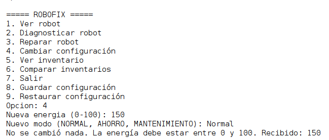 |
| P8 | Configurar un modo desconocido | Rechazar el modo y conservar el estado anterior | "Modo inválido" y el robot conserva su energía y modo anteriores | 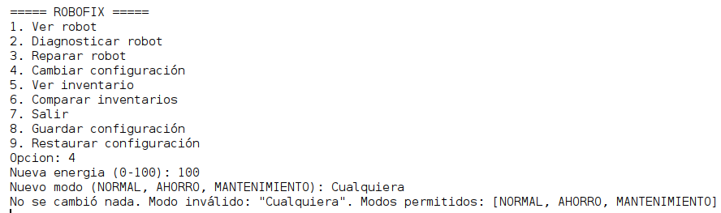 |
| P9 | Guardar, modificar y restaurar el robot | Recuperar la energía y el modo guardados | Se guarda `80 / NORMAL`, se cambia a `30 / AHORRO` y al restaurar vuelve a `80 / NORMAL` | 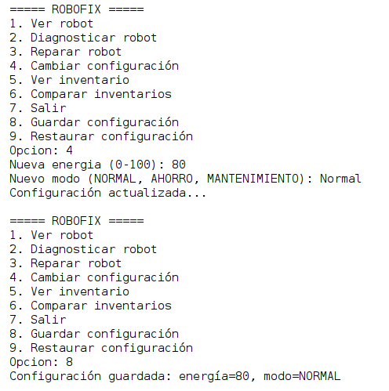 |
| P10 | Restaurar sin haber guardado | Mostrar un mensaje y mantener el estado actual | "No hay una configuración guardada. Usa primero la opción 8." | 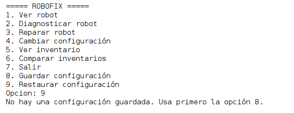 |
| P11 | Reparar sin repuestos suficientes | Informar el fallo y evitar una reparación parcial | "Reparación fallida: no hay stock de BATERIA"; la energía no se descuenta | 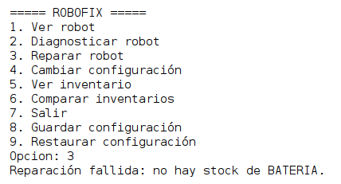 |
| P12 | Revisar `EscanerAntiguo` | Confirmar que no fue modificado | La clase es idéntica a la del código inicial | 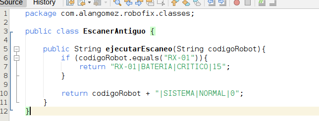 |

---

## Estructura del proyecto

```
RoboFix/
├── imgs/
│ 
├── src/
│   └── main/
│       └── java/
│           └── com/
│               └── alangomez/
│                   └── robofix/
│                       ├── Main.java
│                       ├── classes/
│                       │   ├── Diagnostico.java
│                       │   ├── EscanerAntiguo.java
│                       │   ├── Inventario.java
│                       │   ├── ModoOperacion.java
│                       │   ├── Robot.java
│                       │   ├── Taller.java
│                       │   └── adapters/
│                       │       └── AdaptadorEscanerAntiguo.java
│                       ├── interfaces/
│                       │   └── EscanerExterno.java
│                       ├── memory/
│                       │   ├── Configuracion.java
│                       │   └── HistorialConfiguracion.java
│                       └── util/
│                           └── Menu.java
├── .gitignore
├── pom.xml
└── README.md
```

## Distribución de archivos

| Archivo | Responsabilidad |
|---|---|
| `Main.java` | Punto de entrada. Muestra el menú, lee las opciones del usuario y llama a cada funcionalidad. |
| `util/Menu.java` | Imprime las opciones del menú. |
| `classes/Robot.java` | Representa al robot y protege su estado. Valida energía y modo, y actúa como **Originator** del Memento. |
| `classes/ModoOperacion.java` | Enum con los modos permitidos: `NORMAL`, `AHORRO` y `MANTENIMIENTO`. |
| `classes/Taller.java` | Coordina el diagnóstico y la reparación. Valida todo antes de descontar repuestos o energía. |
| `classes/Inventario.java` | **Singleton**. Única fuente de verdad de los repuestos; nunca permite cantidades negativas. |
| `classes/Diagnostico.java` | Objeto con el resultado del escaneo, ya interpretado y tipado. |
| `classes/EscanerAntiguo.java` | Sistema antiguo de diagnóstico. Simula una biblioteca externa y **no se modificó**. |
| `interfaces/EscanerExterno.java` | Interfaz moderna que espera el taller. |
| `classes/adapters/AdaptadorEscanerAntiguo.java` | **Adapter**. Traduce la respuesta del escáner antiguo a un `Diagnostico` y valida el formato. |
| `memory/Configuracion.java` | **Memento**. Copia inmutable de la energía y el modo del robot. |
| `memory/HistorialConfiguracion.java` | **Caretaker**. Guarda la copia y avisa si no existe ninguna. |
| `assets/` | Capturas de las pruebas de aceptación P1 a P12. |

## Cómo utilizarlo

**Requisitos**

- Java JDK 25
- NetBeans

**1. Clonar el repositorio**

```bash
git clone https://github.com/AlanGomez-Programmer/RoboFix.git
cd RoboFix
```

**2. Ingresa a Netbeans**

- **Opción 1:** En Netbeans ejecuta el archivo main pulsando el boton de ejecutar

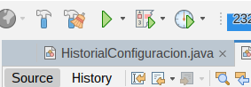

- **Opción 2:** En Netbeans dirigete al archivo Main.js y luego pula las teclas `SHIFT` + `F6`.


**3. Usar el menú**

```
===== ROBOFIX =====
1. Ver robot
2. Diagnosticar robot
3. Reparar robot
4. Cambiar configuración
5. Ver inventario
6. Comparar inventarios
7. Salir
8. Guardar configuración
9. Restaurar configuración
```

Escribe el número de la opción y presiona Enter.

## Conclusión Técnica

En conclusión, se aplicaron los patones de diseño `Adapter`, `Singleton` y `Memento` los cuales fueron fundamentales para que el sistema tenga una mejor estructura para la adaptación del código inicial, la centralización del inventario y el almacenamiento de las configuraciones como también la restauración de los mismo. 

También la aplicación de algunos principios son fundamentales como el principio `Tell, Don't Ask` donde en lugar de hacer la ejecución de los datos por fuera de la clase, la misma instancia contiene sus propios métodos y el dominio de sus atributos, donde se puede reflejar el uso del encapsulamiento.

Se creo un package para las nuevas clases que se incluyeron para aplicar los patrones y poder reflejar un mejor flujo de diseño para no tener todos las clases en un mismo lugar y también se incluyo una interfaz para que la clase `AdaptadorEscanerAntiguo` tenga un contrato y aplicar los métodos con contiene la interfaz.

**Limitaciones**

1. Solo hay un robot por predeterminado, lo cual esta fijo en el Main.Por lo tanto no se puede elegir que robot se puede reparar y que se necesita reparar.

2. Las reglas del taller estan fijas como el quitar 20 de energía y 1 repuesto para todo ya que en realidad raparar un motor es distinto a reparar un sensor.

3. El inventario no se puede reabastecer. Por lo tanto, si el inventario se queda sin stock de un producto, no se puede agregar mas stock para un producto en especifico. 

---

## 👨 AUTOR

Programador Full-Stack Jr. Alan Gomez

GitHub: [AlanGomez-Programmer](https://github.com/AlanGomez-Programmer)

LinkedIn: alan-gomez-763163320